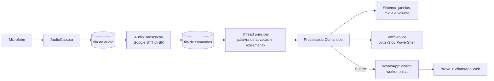

# JAIRO


Assistente virtual por comando de voz para Windows, escrito em Python. O JAIRO escuta o microfone, entende comandos em português e controla o computador (janelas, mídia, volume, capturas de tela), faz contas, cria timers e opera o WhatsApp Web (enviar mensagem, ler não lidas e responder automaticamente).

```
     _   _    ___  ___   ___
  _ | | /_\  |_ _|| _ \ / _ \
 | || |/ _ \  | | |   /| (_) |
  \__//_/ \_\|___||_|_\ \___/      "Jairo, tirar print."
```

> English TL;DR: a Windows voice assistant in Python. Wake word, offline-friendly command routing, Selenium-driven WhatsApp Web (send, read unread, auto-reply), media/volume/window control, voice calculator and timers. Single-file, thread-safe architecture. Commands are in Brazilian Portuguese.

## Sumário

- [O que ele faz](#o-que-ele-faz)
- [Demonstração rápida](#demonstração-rápida)
- [Instalação](#instalação)
- [Configuração](#configuração)
- [Como usar](#como-usar)
- [Arquitetura](#arquitetura)
- [Diagnóstico](#diagnóstico)
- [Segurança e privacidade](#segurança-e-privacidade)
- [Aviso sobre o WhatsApp](#aviso-sobre-o-whatsapp)
- [Documentação](#documentação)
- [Licença](#licença)

## O que ele faz

| Área | Exemplos de comando (sempre começam com "Jairo") |
| --- | --- |
| Captura de tela | "tirar print", "print da tela inteira" |
| Sistema | "bloquear o computador", "desligar o computador", "cancelar desligamento" |
| Janelas | "minimizar tudo", "trocar de janela", "janela para a esquerda", "fechar janela" |
| Mídia e volume | "pausar", "próxima música", "aumentar volume", "volume 50", "mutar" |
| Contas | "quanto é 15 + 14", "20 por cento de 150", "raiz quadrada de 144" |
| Timers | "timer de 5 minutos", "me lembra em meia hora de tomar água", "quanto falta" |
| WhatsApp | "ler mensagens", "enviar mensagem para Maria dizendo estou chegando" |
| Apps e web | "abre o VS Code", "pesquisar receita de bolo", "youtube lofi" |
| Informação | "que horas são", "que dia é hoje", "repetir", "ajuda" |
| Modos | "modo silencioso" (só bipes), "modo falante", "silenciar" (standby) |

Lista completa em [docs/COMANDOS.md](docs/COMANDOS.md).

### Pensado para ser rápido

- **Ações instantâneas executam antes de qualquer fala.** Print, bloqueio, janelas, mídia e volume respondem só com um bipe curto.
- **Microfone aberto continuamente**, sem reabrir a cada frase.
- **Ganho automático** para quem fala baixo, e diagnóstico (`--testar-mic`) que sugere o limite de energia certo para o seu microfone.
- **Modo silencioso** para trocar confirmações faladas por bipes.

### Pensado para ser seguro

- **Palavra de ativação obrigatória:** só comandos que começam com "Jairo" são executados.
- **Contatos ambíguos não são adivinhados.** Se "Gustavo" casar com dois contatos, o JAIRO pede o nome completo.
- **Cálculos sem `eval`:** a calculadora usa uma árvore aritmética com lista de operações permitidas.
- **Sem `shell=True`**, injeção de JavaScript só por argumentos e números mascarados nos logs.

## Demonstração rápida

```text
Você:   Jairo, quanto é 15 + 14
Jairo:  "29"

Você:   Jairo, tirar print
Jairo:  (bipe)  -> o recorte de tela do Windows abre na hora

Você:   Jairo, enviar mensagem para Maria dizendo estou chegando
Jairo:  "Enviando mensagem para Maria Clara."  ...  "Mensagem confirmada para Maria Clara."

Você:   Jairo, ler mensagens
Jairo:  "Você tem 3 mensagens não lidas em 2 conversas. Joao Silva: ..."
```

## Instalação

Requisitos: Windows 10/11, Python 3.10 ou superior, microfone, navegador Brave (ou ajuste `BRAVE_PATH`) e conexão com a internet (o reconhecimento de fala usa a API do Google).

```powershell
git clone https://github.com/Macura076/jairo.git
cd jairo
python -m venv .venv
.venv\Scripts\activate
pip install -r requirements.txt
copy .env.example .env
```

Se o `PyAudio` falhar ao instalar, use uma versão com wheel pré-compilado para a sua versão do Python (`pip install PyAudio --only-binary :all:`).

O Selenium precisa de um `chromedriver` compatível com a versão do Chromium do Brave. As versões recentes do Selenium costumam resolver isso sozinhas; se aparecer `SessionNotCreatedException`, veja [docs/SOLUCAO_DE_PROBLEMAS.md](docs/SOLUCAO_DE_PROBLEMAS.md).

## Configuração

Tudo é opcional e vem de variáveis de ambiente ou do arquivo `.env`. Os principais:

| Variável | Padrão | Para que serve |
| --- | --- | --- |
| `JAIRO_DIR` | `C:\09projec` | Pasta com `contatos.txt`, `permitidos.txt` e o perfil do navegador |
| `BRAVE_PATH` | caminho padrão do Brave | Executável do navegador |
| `JAIRO_PAUSE` | `0.8` | Silêncio (s) que encerra a frase |
| `JAIRO_ENERGY` | `0` | Limite de energia fixo; use `--testar-mic` para descobrir |
| `JAIRO_GANHO_MAX` | `4.0` | Ganho automático para voz baixa (`1.0` desativa) |
| `JAIRO_TTS` | `auto` | `auto`, `pyttsx3` ou `powershell` |
| `JAIRO_SILENCIOSO` | `false` | Confirmações viram bipes |
| `JAIRO_EXIGIR_WAKE` | `true` | Exigir "Jairo" no início do comando |

A lista completa está em [`.env.example`](.env.example).

### Contatos do WhatsApp

Copie `contatos.example.txt` para `contatos.txt` dentro de `JAIRO_DIR`:

```text
# Nome:DDI+DDD+numero[:apelidos]    (prefixo ! desativa um contato)
Maria Clara:5511999990001:mari
Joao Silva:5511999990002
!Joao Antigo:5511999990003
```

E, se quiser o auto-responder, liste em `permitidos.txt` os nomes (como aparecem no WhatsApp) que podem receber a resposta automática. Arquivo vazio significa auto-responder desligado.

## Como usar

```powershell
python jairo.py
```

Na primeira execução com WhatsApp, o Brave abre com o QR Code (você tem 3 minutos). A sessão fica salva no perfil, e nas execuções seguintes a janela fica fora da tela. Diga **"Jairo, ajuda"** para ouvir o resumo dos comandos.

Utilitários:

```powershell
python jairo.py --testar-voz   # testa os dois motores de voz e diz qual funciona
python jairo.py --testar-mic   # mede ruido e voz e sugere JAIRO_ENERGY
```

## Arquitetura

Aplicação em arquivo único, com threads bem definidas e comunicação por filas. O driver do navegador pertence a uma única thread, e a voz sintetizada roda apenas na thread principal (restrição do COM no Windows).



Decisões de projeto:

- **Worker única para o WebDriver.** Nenhuma outra thread toca o driver; pedidos entram por uma fila e devolvem `Future`.
- **Confirmação de envio** por contagem de bolhas de saída no DOM, com estados explícitos (`CONFIRMADO_NA_CONVERSA`, `INSERIDO_NA_INTERFACE`, `FALHOU`).
- **Auto-responder com fingerprint SHA-256 por mensagem**, não por pessoa, para nunca responder duas vezes à mesma mensagem.
- **Retentativas com backoff exponencial e jitter**, e limitador global de envios.
- **Coleta de não lidas resiliente:** script JavaScript tolerante a mudanças do DOM, com fallback para seletores Selenium.
- **Anti-eco:** o microfone descarta o áudio captado enquanto o JAIRO fala.

Detalhes em [docs/ARQUITETURA.md](docs/ARQUITETURA.md).

## Diagnóstico

| Sintoma | O que fazer |
| --- | --- |
| Ele fala, mas não sai som | `python jairo.py --testar-voz` e defina `JAIRO_TTS` conforme o resultado |
| Preciso falar alto ou perto do microfone | `python jairo.py --testar-mic` e defina `JAIRO_ENERGY`; diga "recalibrar microfone" |
| "Você não tem mensagens" mas tenho | Diga "diagnosticar whatsapp" e analise `wpp_diagnostico.json` |
| Mensagem foi para o contato errado | Diga "buscar contato NOME" e corrija o `contatos.txt` |

Mais casos em [docs/SOLUCAO_DE_PROBLEMAS.md](docs/SOLUCAO_DE_PROBLEMAS.md).

## Segurança e privacidade

- O reconhecimento de fala envia o áudio ao serviço de STT do Google. Sem internet, não há escuta.
- A pasta `perfil_jairo/` guarda a **sessão logada do seu WhatsApp**. Quem tiver essa pasta acessa a sua conta. Ela está no `.gitignore`; nunca a publique nem a compartilhe.
- `contatos.txt`, `permitidos.txt`, `autenticado.txt`, `.env` e os logs também estão no `.gitignore`.
- `wpp_diagnostico.json` contém trechos reais da sua lista de conversas. Revise antes de enviar a qualquer pessoa.
- "Fechar janela" usa Alt+F4 na janela em foco; se o terminal do JAIRO estiver em foco, ele será fechado.

## Aviso sobre o WhatsApp

A automação usa o WhatsApp Web por meio do Selenium, o que não é uma integração oficial. O uso de automação pode violar os termos de serviço do WhatsApp e levar à restrição da conta. Use por sua conta e risco, apenas com a sua própria conta e com contatos que esperam receber suas mensagens. Para uso comercial, prefira a API oficial do WhatsApp Business. Este projeto não é afiliado ao WhatsApp, à Meta, ao Google ou à Brave.

## Documentação

- [Lista completa de comandos](docs/COMANDOS.md)
- [Arquitetura e threads](docs/ARQUITETURA.md)
- [Solução de problemas](docs/SOLUCAO_DE_PROBLEMAS.md)
- [Histórico de mudanças](CHANGELOG.md)

## Licença

[MIT](LICENSE).
