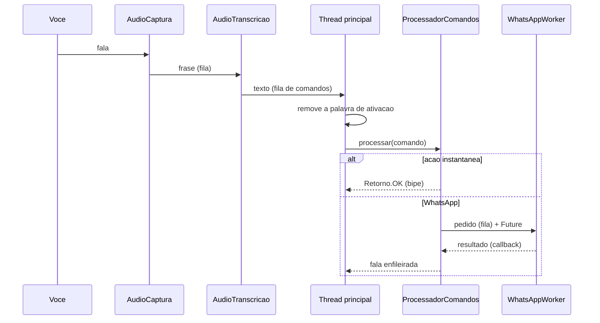

# Arquitetura

O JAIRO é um único arquivo (`jairo.py`) organizado em seções. Cada seção tem uma responsabilidade e conversa com as outras por filas ou por `Future`.

## Threads

| Thread | Quem cria | O que faz |
| --- | --- | --- |
| Principal | Python | Loop de comandos, roteamento, **toda** a fala (TTS), atalhos de teclado e volume |
| `AudioCaptura` | `main()` | Mantém o microfone aberto e grava frases |
| `AudioTranscricao` | `main()` | Aplica ganho e envia a frase ao reconhecedor de fala |
| `WhatsAppWorker` | `main()` | **Única** dona do WebDriver: envios, leitura de não lidas, auto-responder |
| `Timer-N` | `ProcessadorComandos` | Dispara o aviso de um timer (daemon) |

Threads de longa duração são iniciadas somente dentro de `main()`.

## Fluxo de um comando

## Componentes

### `Config`
Dataclass imutável preenchida por variáveis de ambiente (`.env`). Nenhum módulo lê `os.environ` diretamente, exceto `AppLauncher`, que resolve `LOCALAPPDATA`/`APPDATA`.

### `Agenda`
Carrega `contatos.txt` na inicialização e valida cada número (`^[1-9]\d{9,14}$`). Resolução do nome falado:

1. apelido exato (prioridade máxima);
2. todos os termos falados presentes no nome do contato (sem acentos).

Zero resultados levantam `LookupError`; mais de um levanta `ContatoAmbiguo`. O processador de comandos nunca envia para um contato ambíguo. Contatos com prefixo `!` são ignorados. O arquivo de permitidos usa cache por data de modificação.

### `WhatsAppService`
- O driver é criado, usado e encerrado apenas pela `WhatsAppWorker`.
- A API pública (`enviar_para`, `varrer_agora`, `listar_nao_lidos`, `diagnosticar_whatsapp`) enfileira pedidos tipados e devolve `Future`.
- **Navegação:** tenta a API interna via JavaScript (sem recarregar a página) e cai para a URL `send/?phone=`.
- **Destinatário:** após abrir o chat, confere o cabeçalho por polling (até 3 s). Se o chat for outro, aborta o envio e não retenta.
- **Confirmação:** conta bolhas `.message-out` antes e depois do envio.
- **Retentativas:** até 3, com backoff exponencial e jitter; erros permanentes (`DestinatarioInvalido`, `AutenticacaoNecessaria`) não são retentados.
- **Limitador global** de intervalo mínimo entre envios, com jitter.
- **Nenhum `WebElement` é guardado** entre operações: coletas devolvem somente strings, e os chats são re-localizados pelo nome.

### Coleta de não lidas
Um script JavaScript percorre a lista lateral procurando os itens (`listitem`, `row` ou `cell-frame-container`) e detecta "não lida" por `data-testid` ou `aria-label` (português e inglês). Se não achar nada, o Selenium tenta seletores equivalentes. O comando "diagnosticar whatsapp" grava um relatório do DOM para ajustar isso quando o WhatsApp mudar o HTML.

### Auto-responder
A cada `AUTO_RESPONDER_INTERVAL` segundos, a worker coleta as não lidas, filtra por `permitidos.txt`, aplica uma janela mínima de 10 minutos (para você ter tempo de responder) e usa um **fingerprint SHA-256** de nome, prévia e horário para nunca responder duas vezes à mesma mensagem. A varredura manual ("verificar mensagens") ignora a janela, mas respeita o fingerprint.

### Áudio
- `AudioCaptura` abre o microfone **uma vez** e usa `listen(timeout=1)` para poder checar o evento de saída.
- O limite de energia parte de `JAIRO_ENERGY_MIN` e é limitado a `[JAIRO_ENERGY_MIN, JAIRO_ENERGY_MAX]` após a calibração (ou fixado por `JAIRO_ENERGY`).
- Frases baixas recebem ganho automático (até `JAIRO_GANHO_MAX`) antes do reconhecimento.
- **Anti-eco:** `EstadoFala` é compartilhado com o serviço de voz; frases captadas durante a fala do JAIRO, ou até 1 s depois, são descartadas.

### `VozService`
- A fila de fala é consumida **somente na thread principal**.
- O motor `pyttsx3` é recriado a cada fala. Se `runAndWait()` retorna rápido demais para o tamanho do texto, a fala é tratada como silenciosa e repetida via PowerShell/SAPI (o texto vai por variável de ambiente, sem interpolar no script). Duas ocorrências seguidas trocam o backend de vez.
- `falar()` é uma resposta (sempre falada e guardada para "repetir"). `confirmar()` é uma confirmação curta (vira bipe no modo silencioso).

### `ProcessadorComandos`
Recebe o comando já sem a palavra de ativação e devolve um `Retorno`:

- `OK`: ação executada, o `main()` toca um bipe;
- `SEM_SINAL`: o próprio handler já deu feedback (ou não deve haver bipe, como no bloqueio de tela);
- `DESCONHECIDO`: bipe grave de erro.

Ordem de roteamento: desligamento, ações instantâneas (print, bloqueio, janelas, mídia), calculadora, timers, informações e modos, WhatsApp, aplicativos, pesquisa, YouTube. Os gatilhos são casados sobre o texto sem acentos; termos de busca e nomes de contatos usam o texto original.

### Calculadora
`_normalizar_expressao` converte a frase falada em uma expressão aritmética (operadores por extenso, números por extenso, percentuais, raízes, potências, formato brasileiro de números). `_avaliar` percorre a árvore `ast` aceitando somente `+ - * / **` e sinais unários, com limites para potências. Não há `eval`.

### `ControleMidia` e `ControleSistema`
Usam `keybd_event` do `user32` para teclas de mídia, atalhos de janela e captura de tela. O bloqueio usa `LockWorkStation()`, porque o Windows ignora Win+L gerado por software. O volume absoluto usa `pycaw` quando instalado.

## Convenções

- Sem `shell=True`; `subprocess.Popen/run` sempre com lista de argumentos.
- Injeção de JavaScript apenas via `arguments[...]`, nunca por f-string.
- Números de telefone mascarados nos logs.
- Logging com `RotatingFileHandler` (arquivo em nível DEBUG, console em INFO).
- Erros de domínio explícitos (`DestinatarioInvalido`, `AutenticacaoNecessaria`, `ContatoAmbiguo`).
